<p align="center">
<picture>
  <source media="(prefers-color-scheme: dark)" srcset="docs/images/banner-dark.svg">
  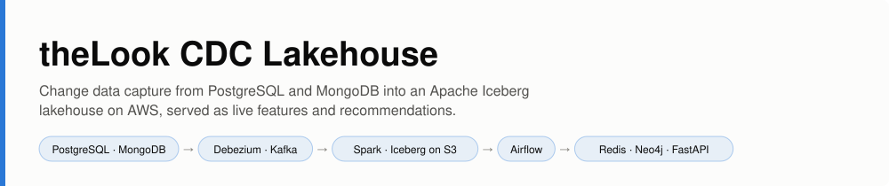
</picture>
</p>

<p align="center">
<a href="https://github.com/SouhailBourhim/TheLook_CDC_LakeHouse/actions/workflows/ci.yml"></a>
</p>

<p align="center">


</p>

<p align="center">
<a href="#see-it-running"><b>See it running</b></a> &nbsp;·&nbsp;
<a href="#architecture"><b>Architecture</b></a> &nbsp;·&nbsp;
<a href="#proven-by-failure-drills"><b>Failure drills</b></a> &nbsp;·&nbsp;
<a href="#gdpr-erasure"><b>GDPR erasure</b></a> &nbsp;·&nbsp;
<a href="#run-it"><b>Run it</b></a> &nbsp;·&nbsp;
<a href="docs/results.md"><b>Results</b></a>
</p>

<p align="center"><sub>
P1 to P8 built, accepted and drilled; P9 (hardening) next. A learning project: the
<a href="docs/cahier-des-charges.md">cahier des charges</a> is the specification, the
<a href="docs/adr/">ADRs</a> hold the reasoning, <a href="docs/results.md">results</a> every measurement.
</sub></p>

## At a glance

<picture>
  <source media="(prefers-color-scheme: dark)" srcset="docs/images/glance-dark.svg">
  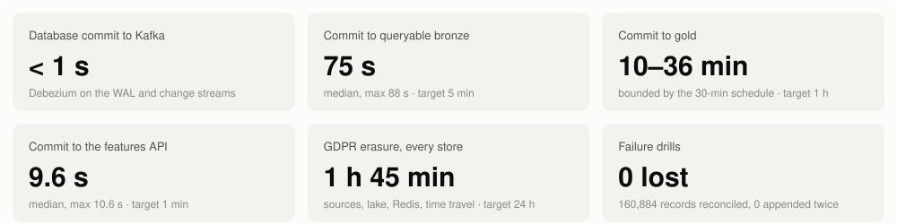
</picture>

## See it running

<p align="center">
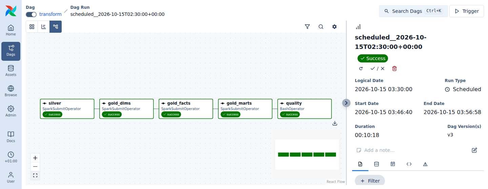
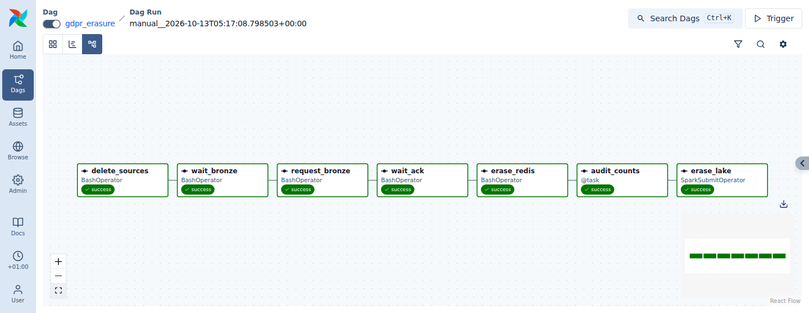
</p>
<p align="center"><sub><b>Airflow</b>: <code>transform</code> refines silver and gold every 30 minutes, then checks the contracts &nbsp;·&nbsp; <b>Airflow</b>: one GDPR erasure, seven steps, 1 h 44 min</sub></p>

<p align="center">
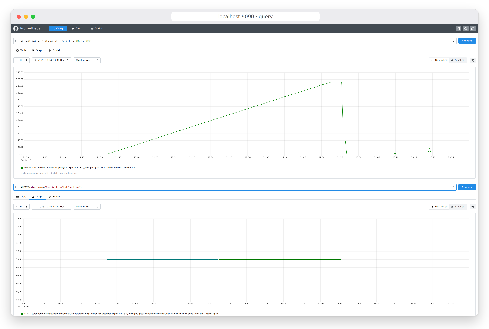
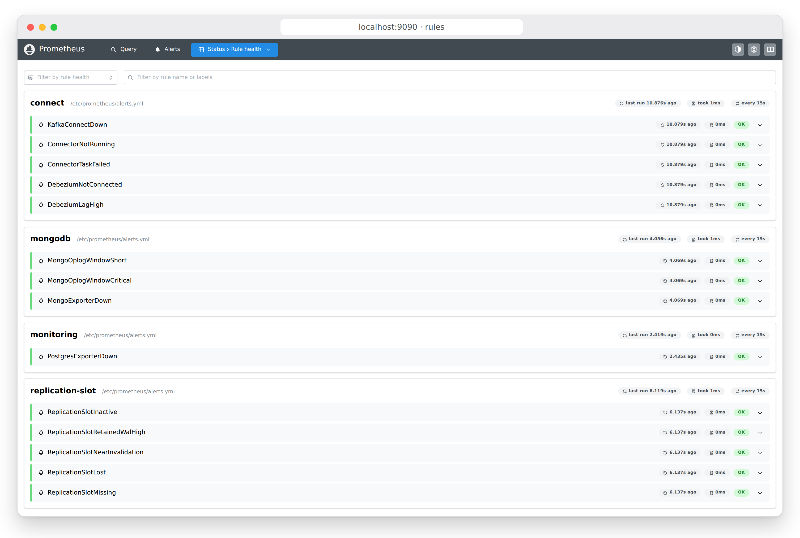
</p>
<p align="center"><sub><b>Prometheus</b>: the slot drill as recorded, WAL piling up while Debezium is stopped and the alert firing after 30 minutes &nbsp;·&nbsp; <b>Prometheus</b>: the 14 alert rules</sub></p>

<p align="center">
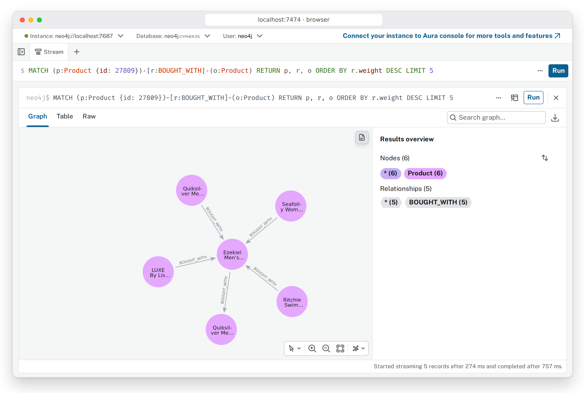
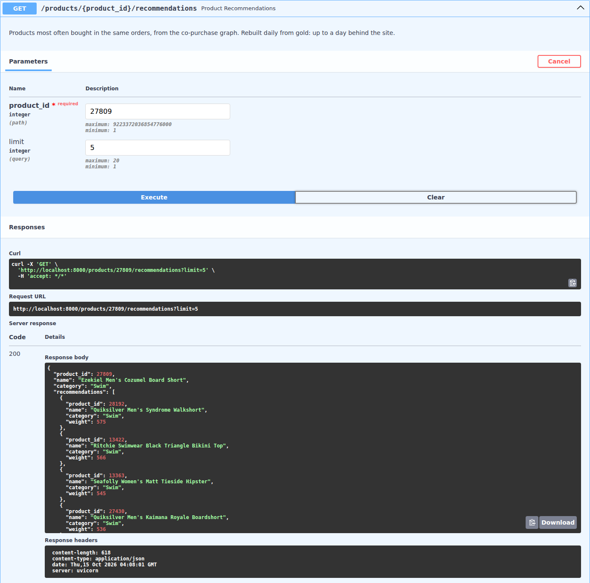
</p>
<p align="center"><sub><b>Neo4j</b>: a product and the five products most often bought with it &nbsp;·&nbsp; <b>FastAPI</b>: the same recommendations served live</sub></p>

## Architecture

<picture>
  <source media="(prefers-color-scheme: dark)" srcset="docs/images/architecture-dark.svg">
  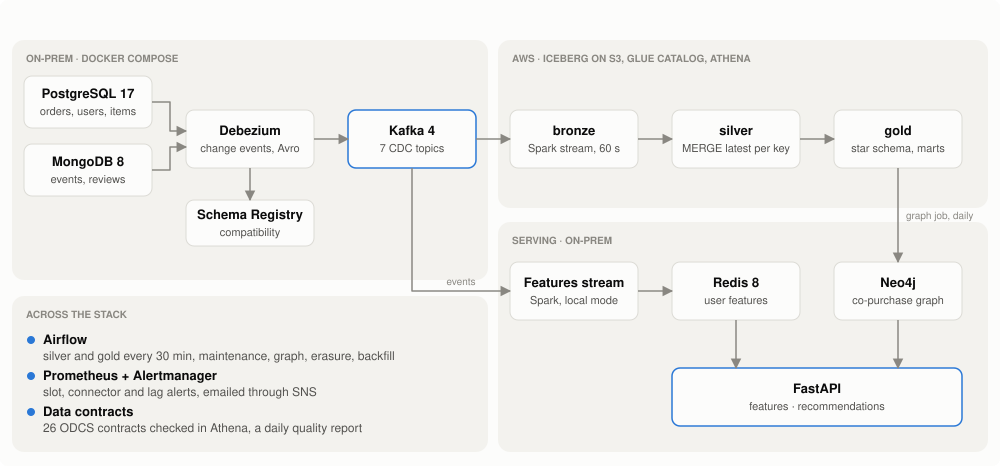
</picture>

Every committed change becomes an Avro event in Kafka; Spark lands it in Apache Iceberg on S3 within
a minute and refines it every 30 minutes under Airflow; Redis and Neo4j serve it through the API.
A diagram for each mechanism: [docs/architecture.md](docs/architecture.md).

### One change, from commit to Athena

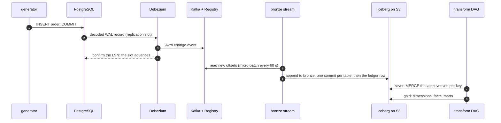

### Exactly once into bronze

Spark replays a batch after a crash (at least once); a mark on every Iceberg commit makes
the replay skip what is already written (exactly once).

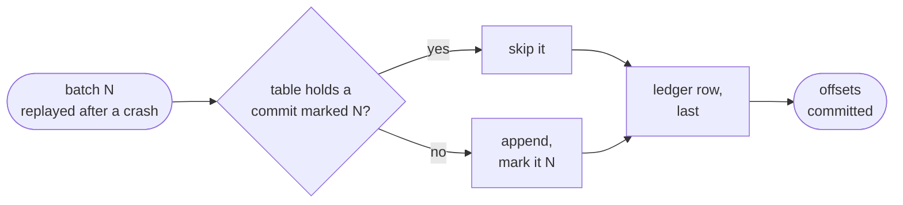

## Proven by failure drills

Each claim below ends with an exact check, and each check was first run against a case that
must fail. The numbers come from [docs/results.md](docs/results.md).

<p align="center">
<picture>
  <source media="(prefers-color-scheme: dark)" srcset="docs/images/drills-reconciled-dark.svg">
  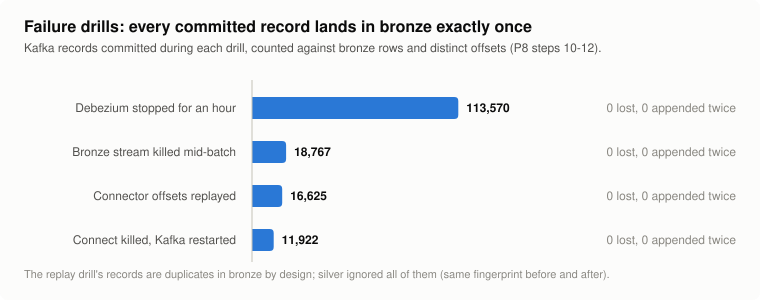
</picture>
</p>

<p align="center">
<picture>
  <source media="(prefers-color-scheme: dark)" srcset="docs/images/slot-drill-dark.svg">
  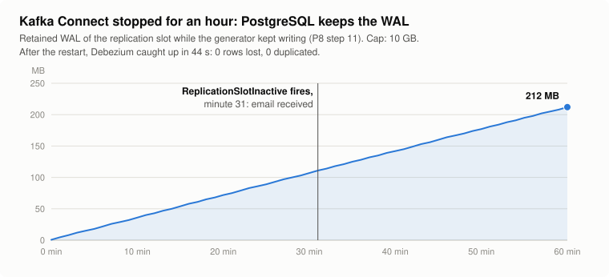
</picture>
</p>

<p align="center">
<picture>
  <source media="(prefers-color-scheme: dark)" srcset="docs/images/backfill-drill-dark.svg">
  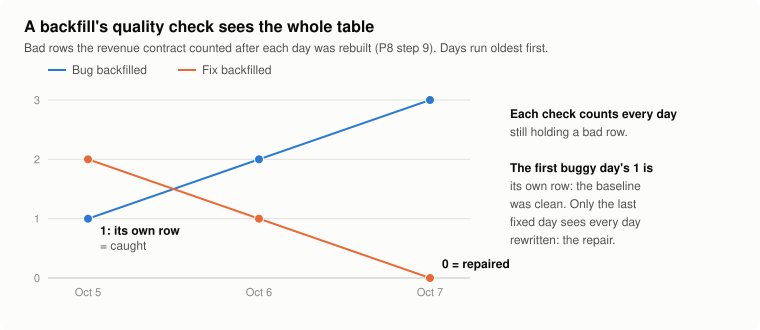
</picture>
</p>


| Drill | What it shows | Result |
|---|---|---|
| Connect `kill -9`, Kafka restarted | exactly-once source: records and offsets in one Kafka transaction | back in 8 s and 10 s; 0 lost, 0 duplicated |
| Debezium stopped for an hour | the replication slot keeps the WAL; the alert reaches an inbox | alert at minute 31, caught up in 44 s |
| Bronze stream killed mid-batch | the replayed batch skips the table it had committed | restarted by Docker in 2 s; no offset twice |
| Connector offsets rewound | bronze takes duplicates, silver's MERGE ignores them | 16,625 duplicates; silver fingerprint unchanged |
| A logic bug backfilled, then fixed | the revenue contract catches it; the fix restores the mart | 15 columns x 3 days equal to the pre-bug snapshot |
| Neo4j frozen (`docker pause`) | the API fails fast instead of hanging | 503 within 2 s, back 0.1 s after unpause |

The drills found four real defects, all fixed and tested: a partial bronze purge, a source
check blind once Kafka retention trims a topic, MongoDB updates read late arriving without a
document, and a 120 s hang on a frozen Neo4j.

## GDPR erasure

One request removes a user from both sources, bronze, silver, gold, Redis and the time travel
of every table, and leaves an audit that never holds the identifier.

<picture>
  <source media="(prefers-color-scheme: dark)" srcset="docs/images/erasure-dark.svg">
  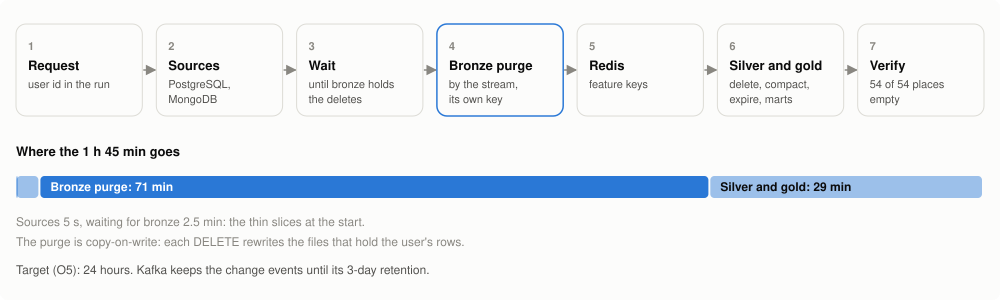
</picture>

## Roadmap

<picture>
  <source media="(prefers-color-scheme: dark)" srcset="docs/images/roadmap-dark.svg">
  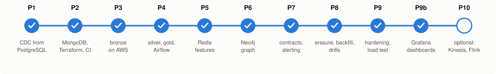
</picture>

## What is built

| Component | Built in | Topics / location |
|---|---|---|
| PostgreSQL capture (5 tables + heartbeat) | P1 | `thelook.shop.<table>` |
| MongoDB capture (`events`, `reviews`) | P2 | `thelook_mongo.web.<collection>` |
| S3 bucket, Glue databases, Athena workgroup, budgets | P2 (Terraform) | `infra/terraform/lake` |
| Monitoring: slot, connector and Debezium lag alerts | P1 | Prometheus, Alertmanager |
| CI: ruff, pytest, alert-rule tests | P2 | `.github/workflows/ci.yml` |
| Bronze: Spark Structured Streaming -> 7 Iceberg tables (S3 + Glue), queryable in Athena | P3 | `lake.thelook_bronze.<database>_<table>` |
| Silver: incremental MERGE, latest version per key (batch IAM user) | P4 | `lake.thelook_silver.<table>`, `make spark-run JOB=jobs/silver.py` |
| Gold: star schema (dim_user SCD2, facts, marts) | P4 | `lake.thelook_gold.*`, `make spark-run JOB=jobs/gold.py` |
| Orchestration: `transform` (silver -> gold, every 30 min), `maintenance` (silver/gold upkeep, daily), `graph` (daily, P6), one-slot pool `lake` | P4 | `airflow/dags/`, UI `http://localhost:8088` |
| Table upkeep: bronze by the stream (hourly expiry, rotating compaction and orphan removal), silver/gold by the `maintenance` DAG | P4 | `spark/lakehouse/upkeep.py` |
| Durability: Kafka fsyncs every write; verify drill + key-filtered re-snapshot after an unclean shutdown | P4 | `drills/verify_silver.py`, `drills/resnapshot.py` |
| Online user features: last 10 products viewed (72 h), current cart, events in the last hour; a separate Spark stream into Redis (ACL users, AOF) | P5 | `spark/jobs/features_stream.py`, keys `user:{id}:*` |
| Serving API: `GET /users/{id}/features` (404 unknown, 503 Redis down), OpenAPI docs | P5 | `api/`, `http://localhost:8000/docs` |
| Co-purchase graph: pairs from gold order items, weight = orders holding both; full idempotent rebuild into Neo4j, never empty | P6 | `spark/jobs/graph.py`, `(:Product)-[:BOUGHT_WITH]->(:Product)` |
| `GET /products/{id}/recommendations` (top N by weight, 404 / `[]` / 422 / 503); `/health` liveness, `/ready` both stores | P6 | `api/`, Neo4j Browser `http://localhost:7474` |
| Data contracts: 26 ODCS files (silver and gold with quality rules, bronze schema only), linted in CI, tested in Athena as a read-only identity; our own drift check (datacontract-cli ignores new columns) | P7 | `contracts/` |
| Quality: a `quality` task ending `transform`; a daily `quality_report` DAG (contracts, drift, freshness, exact source-to-silver reconciliation, health); dead letters kept in silver | P7 | `airflow/dags/quality_report.py`, `lake.thelook_silver.dead_letters` |
| Alerting: one hub, Alertmanager, emailing through SNS; every failed Airflow task alerts; MongoDB oplog window alert | P7 | `onprem/monitoring/`, `infra/terraform/lake/alerts.tf` |
| GDPR erasure: one request removes a user from both sources, bronze (by the stream), silver, gold, the daily marts, Redis and time travel, with an audit that never holds the id; 1 h 45 min measured (O5: 24 h) | P8 | `airflow/dags/gdpr_erasure.py`, `drills/request_erasure.py`, `drills/verify_erasure.py` |
| Backfill: recompute gold for a day range from silver, a day replaced whole, contracts checked after each day | P8 | `airflow/dags/backfill.py`, `drills/backfill_drill.py` |
| Failure drills (FR14): Connect killed, Kafka restarted, Debezium stopped an hour, stream killed mid-batch, offsets replayed, Neo4j frozen; each ends with an exact check | P8 | `drills/`, runbook "Failure drills" |

## Repository layout

Folders are added in the commit that first needs them.

| Path | Contents | Phase |
|---|---|---|
| `onprem/` | Docker Compose stack: Postgres, MongoDB, generator, review simulator, Kafka, Schema Registry, Kafka Connect, monitoring | P1, P2 |
| `onprem/generator/` | Vendored theLook generator with our patches (see its `NOTICE`) | P1, P2 |
| `onprem/review-simulator/` | Synthetic reviews in MongoDB | P2 |
| `onprem/mongo/` | Replica set keyfile wrapper and idempotent setup (users, collections) | P2 |
| `infra/terraform/` | AWS resources: S3, Glue, Athena, budgets (IAM in P3) | P2 |
| `spark/` | PySpark jobs (streaming bronze, silver, gold, features, graph) and their tests | P3 to P6 |
| `api/` | Serving API (FastAPI) and its tests | P5, P6 |
| `onprem/redis/` | Redis configuration and ACL users | P5 |
| `drills/` | Reconciliation and failure drills | P1 onwards |
| `scripts/` | Helpers (cost report, one-off event history copy) | P1 onwards |
| `.github/workflows/` | CI | P2 onwards |
| `contracts/` | ODCS data contracts, their runner, the drift check and the daily quality report | P7 |
| `docs/` | Specification, ADRs, learning log, runbook, results, source schema, architecture diagrams, command reference | All |

## Run it

Needs Docker with Compose v2, [uv](https://docs.astral.sh/uv/), and RAM for
the profiles you start (measured with `docker stats`, generator at 5/s; it
counts page cache for Kafka and MongoDB, so it is an upper bound):

| Profile | Services | RAM |
|---|---|---|
| `core` | postgres, mongo, generator, review-simulator, kafka, schema-registry, connect | ~4.6 GB (mongo 1.1, kafka 1.0, postgres 0.9, connect 0.8, registry 0.7) |
| `monitoring` | postgres-exporter, mongodb-exporter, prometheus, alertmanager | ~0.1 GB (Prometheus grows with its 7-day history) |
| `stream` | spark-master, spark-worker | ~0.5 GB idle; executors up to the worker's 3 GB cap, plus ~1 GB per driver |
| `airflow` | airflow-db, -apiserver, -scheduler, -dag-processor | ~0.9 GB idle; the scheduler (capped at 3 GB) hosts the Spark drivers |
| `serving` | redis, features-stream, neo4j, api | ~2.4 GB (features-stream 1.3-1.4 GB, capped at 2 GB; Neo4j 0.8 GB idle, 0.9 GB while the graph loads, capped at 1.5 GB; Redis ~60 MB; API ~45 MB); needs `core`, not `stream`; no AWS access |

```bash
cp onprem/.env.example onprem/.env     # then set every password
make up PROFILES="core monitoring"     # starts and waits until healthy
onprem/postgres/apply-sql.sh onprem/postgres/cdc-setup.sql         # Debezium role + publication
onprem/postgres/apply-sql.sh onprem/postgres/monitoring-setup.sql  # exporter role
onprem/postgres/apply-sql.sh onprem/postgres/reviewer-setup.sql    # review simulator role
make register-connectors               # Debezium Postgres + MongoDB, then status
make up PROFILES="core stream"         # adds the Spark cluster (UI http://localhost:8080)
make spark-run JOB=jobs/smoke_test.py  # Kafka, Avro and Glue catalog checks on the cluster
make up PROFILES="core stream airflow" # adds Airflow: UI http://localhost:8088 (user admin, AIRFLOW_ADMIN_PASSWORD)
make snapshot-postgres                 # P3: blocking re-snapshot so bronze starts complete
make up PROFILES="core serving"        # P5, P6: Redis, features stream, Neo4j, API (http://localhost:8000/docs)
# bronze-stream (stream profile) appends every CDC topic to lake.thelook_bronze.* every 60 s
make ps                                # what is running
make down                              # stop everything, keep the data
```

The `transform`, `maintenance` and `graph` DAGs start paused on a fresh Airflow
database: unpause them in the UI. **Data transfer:** Spark on the laptop
reads S3 over the internet, ~0.8 GB per hour with `stream` and `airflow` up
(the free allowance covers ~125 hours a month): run those profiles while
working or demoing, `make down` otherwise. Always stop with `make down`: a
killed Kafka (sleep, crash) triggers the verify drill (runbook).

The SQL scripts need the generator's tables, which it creates on its first
start; if one reports a missing table, run it again a few seconds later
(all are idempotent). MongoDB needs no manual step: the one-shot
`mongo-init` service initiates the replica set and creates the users on
every `up`. The review simulator logs errors and retries until its Postgres
role exists. After a reboot, rerun `make up` (no restart policy on purpose).

| What | Where |
|---|---|
| Change events (Avro) | Kafka `localhost:9092`: `thelook.shop.<table>`, `thelook_mongo.web.<collection>` |
| Schemas | Schema Registry `http://localhost:8081/subjects` |
| Connector state | `make connector-status`, Connect REST `http://localhost:8083` |
| MongoDB | `mongodb://localhost:27017/?directConnection=true` (`directConnection`: the replica set member is named `mongo`, which only resolves inside Compose) |
| Metrics and alerts | Prometheus `http://localhost:9090`, Alertmanager `http://localhost:9093` |
| Co-purchase graph | Neo4j Browser `http://localhost:7474` (user `neo4j`, `NEO4J_PASSWORD`) |
| Every command, by task | [docs/commands.md](docs/commands.md) |

Checks and drills: `uv run drills/verify_cdc.py [source ...]` (Kafka vs
both databases, with the generator and review simulator stopped),
`uv run drills/verify_silver.py` (silver vs both databases, every column),
`uv run drills/freshness.py` (O1) and `uv run drills/gold_freshness.py` (O2),
`drills/slot-drill.sh`, `drills/throughput-baseline.sh`. Results in
[docs/results.md](docs/results.md), procedures in
[docs/runbook.md](docs/runbook.md).

Every command of the project, grouped by task (stack, capture, Spark,
Airflow, queries, serving, drills, tests, AWS), with ports and UIs:
[docs/commands.md](docs/commands.md).

## Demos, phase by phase

About three minutes each, with the talking points an interviewer would probe.

<details>
<summary><b>How to demo P2 (about 3 minutes)</b></summary>

```bash
make up && make connector-status            # 2 connectors RUNNING
# 1. A document written to MongoDB is a Kafka event within a second:
docker compose -f onprem/compose.yaml exec schema-registry \
  kafka-avro-console-consumer --bootstrap-server kafka:29092 \
  --topic thelook_mongo.web.reviews --property schema.registry.url=http://localhost:8081
#    -> c (new review), u (helpful vote, edit: full document in "after"), d + tombstone
# 2. Schemaless documents: "after" is a JSON string; only cart events carry
#    product_id and price. Show one event and one review side by side.
# 3. Correctness: stop the writers, then prove Kafka = sources, all 7:
docker compose -f onprem/compose.yaml stop generator review-simulator
uv run drills/verify_cdc.py                 # ALL OK (about 3 minutes)
# 4. Show it can fail: stop connect, change a review in MongoDB, run
#    `verify_cdc.py reviews` (differ=1), start connect, run it again (OK).
```

Talking points: why a replica set for one node, oplog vs replication slot,
why `thelook_mongo` and not `thelook-mongo` (Avro names), why the history
was copied before the connector's snapshot.

</details>

<details>
<summary><b>How to demo P4 (about 3 minutes)</b></summary>

With `core stream airflow` up and both DAGs unpaused:

```bash
# 1. Airflow UI (http://localhost:8088): transform green every 30 minutes,
#    silver -> gold_dims -> gold_facts -> gold_marts; maintenance daily.
# 2. Gold answers questions in Athena (workgroup thelook), e.g. revenue by
#    country *as the customer's address was when they ordered* (SCD2):
#    SELECT u.country, sum(f.gross_amount) FROM thelook_gold.fct_order_items f
#    JOIN thelook_gold.dim_user u ON f.user_sk = u.user_sk GROUP BY 1
# 3. Freshness: a just-committed order reaches gold in under an hour (O2):
uv run drills/gold_freshness.py
# 4. Correctness: stop the writers, let bronze go idle, run silver, then
#    prove silver = sources, every column of all 7 tables:
uv run drills/verify_silver.py              # ALL OK (about 7 minutes)
```

Talking points: the 16 seconds Kafka lost in a crash and how they were found
and repaired (exactly-once assumes the broker keeps what it acknowledged);
the batch ledger and consistent cut; why silver's watermark is an
`ingested_at`, not a snapshot id; merge-on-read and why maintenance is
not optional (a 487 KB metadata file slowed the stream); what each run
costs in S3 transfer and why it does not go lower (random keys).

</details>

<details>
<summary><b>How to demo P5 (about 3 minutes)</b></summary>

With `core serving` up (no AWS cost):

```bash
# 1. A user's features, typed and documented (http://localhost:8000/docs):
curl -s localhost:8000/users/<user id>/features | python3 -m json.tool
#    (a user id: redis-cli as admin, SCAN 0 MATCH user:*:viewed)
# 2. Freshness: the next product view by a real user is served within
#    ~10 s of its MongoDB commit (target < 1 minute), API p99 ~4 ms:
uv run drills/features_freshness.py 5
# 3. Correctness by construction: rebuild everything from Kafka and compare
#    with what the live stream built, key by key, expiry to the millisecond:
uv run drills/features_rebuild.py           # 224,587 / 224,587 identical
# 4. Isolation: stop Redis for 5 minutes; the API answers 503 in 1 s, the
#    stream restarts and catches up, bronze never notices:
uv run drills/redis_outage.py 300
```

Talking points: why sorted sets with `ZADD GT` and not list pushes (a
replayed batch must change nothing); "events in the last hour" counted at
read time, not with `INCR`; TTLs from event time, so a rebuild gives the
same expiries; a TTL bounds a key, not its members (the 72 h window on
viewed); why `failOnDataLoss=false` here and `true` for bronze; the 503 that
took 60 s (redis-py's default retries and DNS for a stopped container).

</details>

<details>
<summary><b>How to demo P6 (about 3 minutes)</b></summary>

With `core serving` up, and a graph built by the `graph` DAG (it needs
`stream` and `airflow` to have run; serving the graph does not):

```bash
# 1. The most popular product's neighbours, heaviest first:
curl -s "localhost:8000/products/27809/recommendations?limit=5" | python3 -m json.tool
#    -> its 5 companion products (weights 159-184 on 2026-10-10), nothing else close
# 2. The same in Neo4j Browser (http://localhost:7474):
#    MATCH (p:Product {id: 27809})-[r:BOUGHT_WITH]-(o) RETURN p, r, o
#    ORDER BY r.weight DESC LIMIT 5
# 3. Acceptance: top 20 most-purchased products have >= 4 companions in
#    their top 5, and same-category recommendations beat the random baseline:
uv run drills/recommendations_affinity.py
# 4. Failure: stop Neo4j; recommendations answer 503 in 1 s, the features
#    endpoint keeps working, /health stays 200 and /ready names neo4j:
docker compose -f onprem/compose.yaml stop neo4j
curl -s localhost:8000/ready; curl -s -o /dev/null -w '%{http_code}\n' localhost:8000/products/27809/recommendations
docker compose -f onprem/compose.yaml start neo4j   # 200 again ~9 s later, no API restart
```

Talking points: why a full rebuild and not `weight += n` (weights must go
down after an erasure; a replayed batch would count twice); write first,
delete stale after, so the API never sees an empty graph; one writer
because parallel `MERGE`s on popular products deadlock; why companions
come from a sha256 rule (any tool can recompute them, so the acceptance is
exact); liveness vs readiness, and why a readiness probe on shared stores
turns a partial outage into a total one; the 500 a fake could not find
(Neo4j reports a query timeout as a `ClientError`).

</details>

<details>
<summary><b>How to demo P7 (about 3 minutes)</b></summary>

With `core stream airflow monitoring` up:

```bash
# 1. A contract is the table's definition, checked in Athena (read-only user):
docker compose -f onprem/compose.yaml exec airflow-scheduler sh -c \
  'cd /opt/contracts && /opt/datacontract/venv/bin/python check.py gold/fct_orders.odcs.yaml'
# 2. The daily report: Airflow UI, DAG quality_report, five green tasks
#    (contracts, drift, freshness, exact reconciliation, health).
# 3. A compatible column flows, and the drift check still catches it:
uv run drills/schema_compatible.py          # registry 5 s, bronze 20 s, silver next run
# 4. An incompatible type change is blocked and emails within ~2 minutes,
#    then the scripted recovery (one ALTER, offset moved, resume):
uv run drills/schema_breaks.py incompatible
```

Talking points: why datacontract-cli alone misses a new column (and why
that matters for personal data); Athena's 10 MB minimum per query, which
decided what runs every 30 minutes; why the reconciliation reads bronze as
of the batch ledger (tables commit one by one); why a failed task gets no
"resolved" email; the recovery that failed
the first time (restoring a value while the column still had the bad type).

</details>

<details>
<summary><b>How to demo P8 (about 3 minutes)</b></summary>

With `core stream airflow` up:

```bash
# 1. Erase a user everywhere, then prove it (time travel included):
uv run drills/verify_erasure.py --capture <user_id>
uv run drills/request_erasure.py <user_id> --wait   # ~1 h 45 min under load
uv run drills/verify_erasure.py <user_id> <request_id>
# 2. A logic bug reaches the revenue mart through a backfill, the contract
#    catches it, the fix is backfilled, the mart equals its pre-bug snapshot:
uv run drills/backfill_drill.py 2026-10-05 2026-10-07
# 3. Kill Connect and restart Kafka under load: 0 lost, 0 duplicated
uv run drills/connect_kafka_restarts.py
# 4. Replay 15 minutes of MongoDB changes: bronze duplicates, silver unchanged
uv run drills/offsets_replay.py
```

Talking points: why bronze is purged by the stream and not by Airflow (one
writer, one key that can delete it); why the erasure waits until each key's
*latest* event in bronze is a delete; why a backfill's quality check speaks
for the range on its last day only; how the drills found a silver bug
(MongoDB updates read late have no document) and a 120 s hang (a frozen
Neo4j and the driver's read timeout); why a check is first run against a
case that must fail.

</details>

## Design decisions

Each has an ADR with the alternatives and consequences.

| Decision | Why | ADR |
|---|---|---|
| Self-hosted Kafka, not Kinesis/MSK | Industry standard, $0 locally (MSK Serverless ~$540/month) | [001](docs/adr/001-kafka-over-kinesis.md) |
| Postgres: pgoutput, pre-created publication, slot cap | No plugin to install; Debezium never owns tables; a stalled slot cannot fill the disk | [002](docs/adr/002-postgres-source-configuration.md), [004](docs/adr/004-cdc-access-model.md) |
| Connect image built from apache/kafka + checksummed plugins | One Kafka version everywhere; explicit supply chain | [003](docs/adr/003-kafka-connect-worker-image.md) |
| Prometheus + Alertmanager on-prem | Slot and lag alerts with unit-tested rules | [005](docs/adr/005-on-prem-monitoring.md) |
| Bronze tables created by their writer, validated by contracts | New nullable columns flow without a deploy | [006](docs/adr/006-bronze-table-ownership.md) |
| Spark Structured Streaming writes bronze; Iceberg, not Delta | One engine for stream and batch; Athena writes Iceberg (MERGE, VACUUM), only reads Delta | [007](docs/adr/007-spark-streaming-bronze-writer.md) |
| MongoDB holds clickstream and reviews, one document per event | One source of truth per dataset; append-only inserts, not growing session documents | [008](docs/adr/008-mongodb-second-cdc-source.md) |
| PySpark builds silver and gold, not dbt | One engine, logic unit-tested with pytest + chispa | [009](docs/adr/009-pyspark-instead-of-dbt.md) |
| Redis + Neo4j + FastAPI serving layer | Each store fits its access pattern; TTLs bound personal data | [010](docs/adr/010-serving-layer.md) |
| Spark 4.1 + Iceberg 1.12, jars baked and checksummed in one image | Driver and executors on one Python; no download at run time | [011](docs/adr/011-spark-runtime-and-versions.md) |
| Bronze: one table per source table, envelope kept, replay guard, batch ledger | Exactly-once appends; silver reads a consistent cut across tables | [012](docs/adr/012-bronze-table-design.md) |
| Airflow on the Spark image, spark-submit in client mode | Same Python as the executors; no Docker socket in Airflow | [013](docs/adr/013-airflow-runtime.md) |
| Silver: incremental MERGE by log position, merge-on-read, `ingested_at` watermark | Idempotent replays; reads only new bronze files | [014](docs/adr/014-silver-design.md) |
| Gold: star schema, dim_user SCD2 rebuilt each run, unknown member, written metric definitions | Orders keep the address of their time; inner joins drop nothing | [015](docs/adr/015-gold-model.md) |
| Kafka fsyncs every write (single broker) | No silent loss of acknowledged records on a crash (one happened) | [016](docs/adr/016-kafka-fsync-single-broker.md) |
| Each layer maintained by its writer | No key that can delete bronze ever enters Airflow | [017](docs/adr/017-table-maintenance.md) |
| Features: a separate Spark stream in local mode; max/union values in Redis; TTLs from event time | No AWS key, cannot slow bronze; replays and rebuilds give the same state | [018](docs/adr/018-online-features.md) |
| Graph: companion products in the generator, full rebuild stamped with a run id, one writer, liveness `/health` + readiness `/ready` | Exact acceptance; idempotent and erasure-proof; never an empty graph; a store outage never restarts the API | [019](docs/adr/019-co-purchase-graph.md) |
| Contracts per table, checks in Athena as a read-only user, own drift check, dead letters, one alert hub (Alertmanager -> SNS email) | A drift or a broken rule fails a check instead of passing silently; no laptop transfer; every alert reaches one inbox | [020](docs/adr/020-contracts-quality-alerting.md) |
| Erasure through every layer (bronze purged by the stream), day-range backfill as an Airflow DAG, failure drills with exact checks | Erased everywhere within O5 with an audit that holds no identifier; a backfill can never duplicate; each FR14 claim is evidence | [021](docs/adr/021-erasure-and-backfill.md) |

## After cloning

Enable the versioned Git hooks once per clone. The pre-push hook scans the
commits being pushed with gitleaks (in Docker) and blocks the push if it
finds a secret:

```bash
git config core.hooksPath .githooks
```

## Documentation

- [Cahier des charges](docs/cahier-des-charges.md)
- [Architecture decision records](docs/adr/)
- [Learning log](docs/learning-log.md)
- [Source schema](docs/source-schema.md)
- [Results](docs/results.md) and [runbook](docs/runbook.md)
- [Architecture in diagrams](docs/architecture.md) and [command reference](docs/commands.md)

## License

Apache License 2.0, see [LICENSE](LICENSE). The vendored generator is
Apache 2.0 too (Factor House); see `onprem/generator/NOTICE`.
