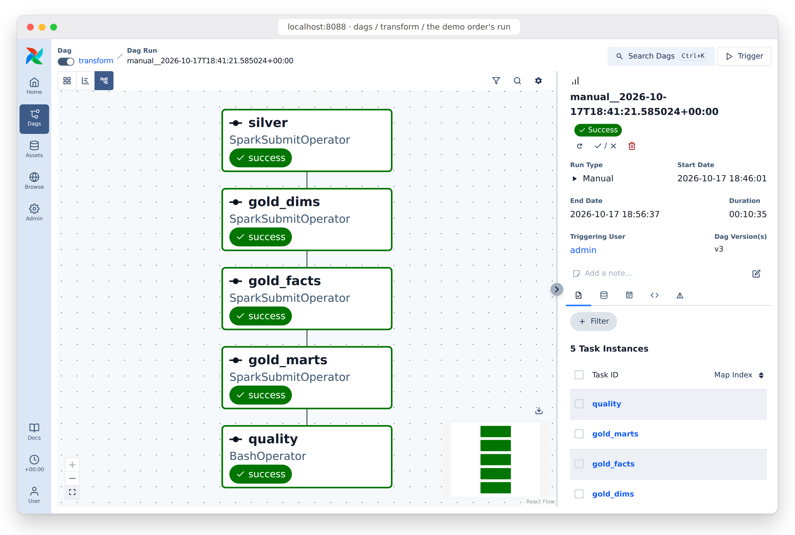
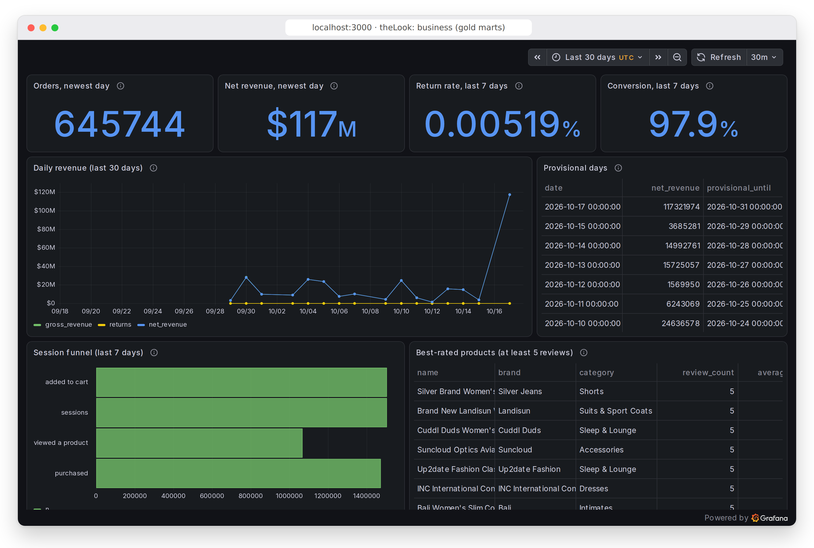
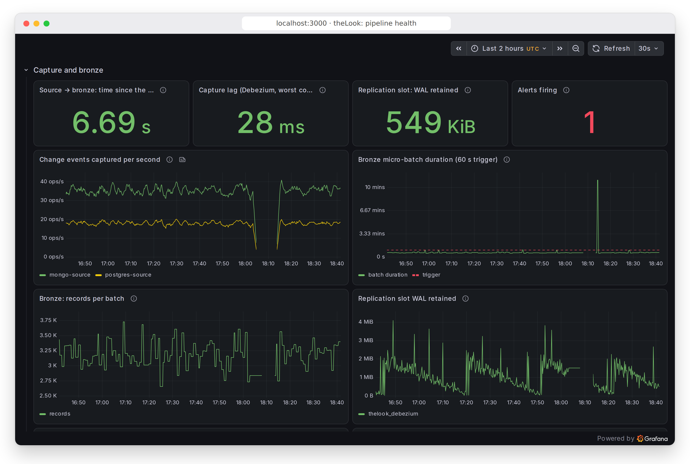

# Demo: one order, from the shop to the dashboard

The story from spec section 10, shown with captures of a real run
(2026-10-17, 18:39-18:56 UTC) instead of a video (Souhail's decision,
spec v2.5): the generator creates an order, the order is returned, and the
change reaches the analytics tables and the dashboard. Reproduce it with
`uv run drills/demo_order.py` (profiles `core monitoring stream airflow bi`
up); it prints the timings below.

## 1. The shop writes, Debezium reads the log

The generator created order `de66aba8-c62e-4ca9-90f1-1e4ca7590817` in
PostgreSQL at 18:39:48. The helper then returned it: status `Returned` on
the order and its item, **in one transaction** (as the generator itself
does since P9). Debezium read both changes from PostgreSQL's write-ahead
log: the pipeline never queries the shop's tables (only the helper did, to
pick the newest order).

## 2. Bronze keeps every version

Both changes in `thelook_bronze.shop_orders`, queried in Athena: the
creation (`c`) and the return (`u`), appended, never overwritten.

| op | status | source_ts (commit in PostgreSQL) | ingested_at (bronze batch) |
|---|---|---|---|
| c | Processing | 18:39:48.710 | 18:40:09.535 |
| u | Returned | 18:40:18.378 | 18:41:09.002 |

The helper saw the order in bronze **29 s** after picking it, the return
**63 s** after writing it: one 60 s trigger plus a batch (O1: under
5 minutes; the load test's p95 at the O8 load was 105 s).

## 3. Airflow merges it into silver and gold

The transform run that carried it (triggered by the helper, queued behind
the scheduled 18:30 run): incremental MERGEs into silver, then gold's
dimensions, facts and marts, then the data contracts (`quality`). Every
task on its first try.

In gold, the order now reads:

| order_id | status | is_returned | gross | returned | order_date_key |
|---|---|---|---|---|---|
| de66aba8-... | Returned | true | 260.95 | 260.95 | 20261017 |

## 4. The dashboard

Grafana's business dashboard reads the revenue mart through Athena: the
day's returns include this order (the mart held 3,149.43 of returns for
10-17 after this run). The day stays in "Provisional days" until its
return window closes (FR6).

And the pipeline that moved it: capture lag in milliseconds, a bronze
batch every minute, under the 60 s trigger.

## What it shows

- Change data capture from the database log, with no reload and no
  query against the shop's tables.
- An append-only history in bronze: every version kept, which is what
  lets silver and gold be rebuilt and dim_user keep its versions (SCD2).
- Incremental, idempotent MERGEs on Iceberg, checked by contracts before
  anyone reads the result.
- From the shop's commit to the dashboard: about a minute to bronze, then
  the next transform run (every 30 minutes; O2: gold under an hour).
