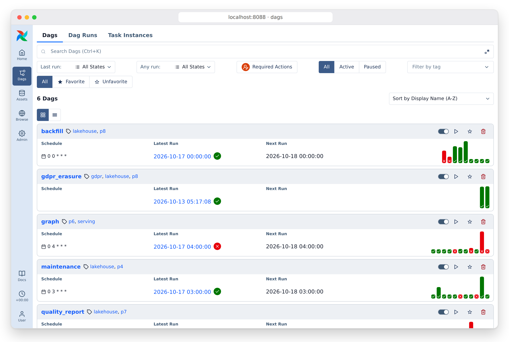
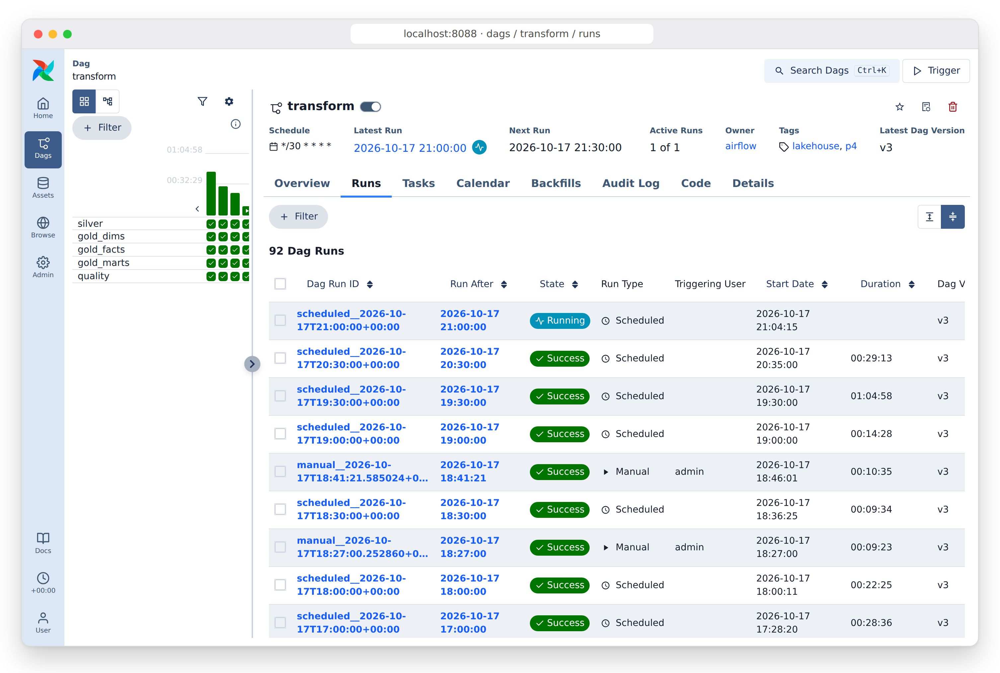
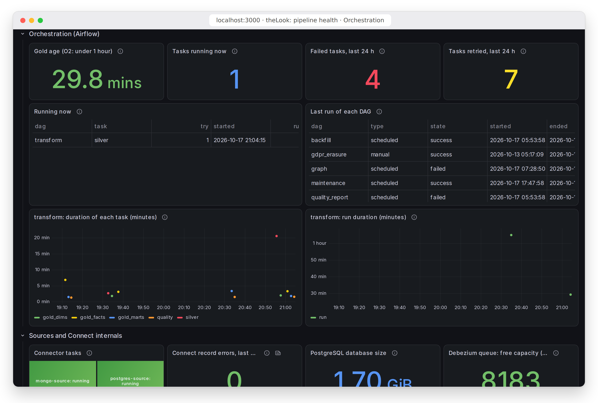
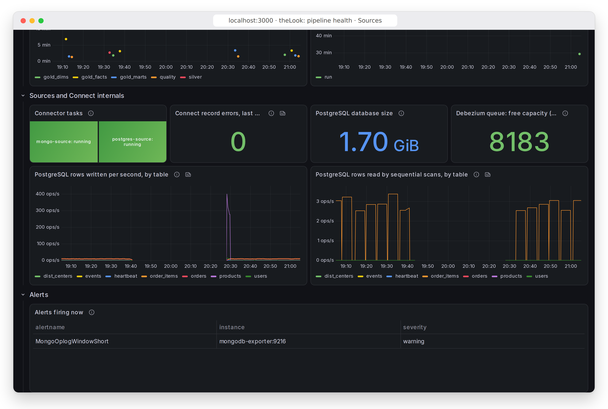
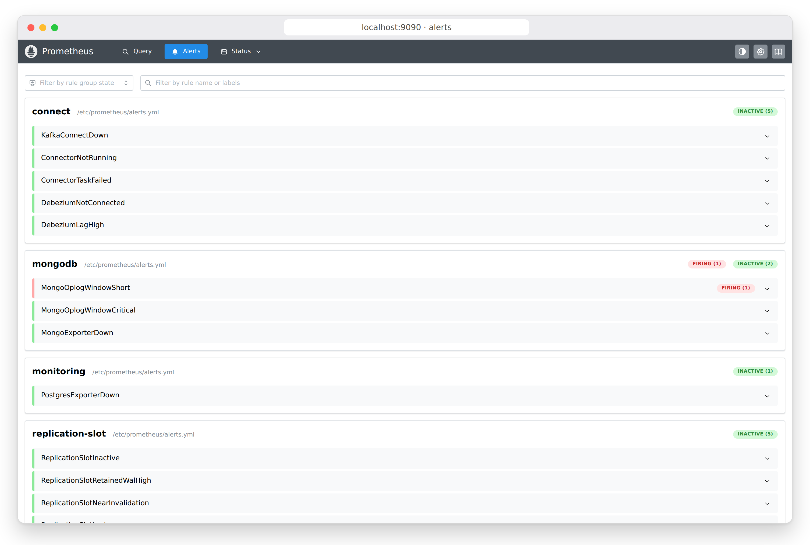
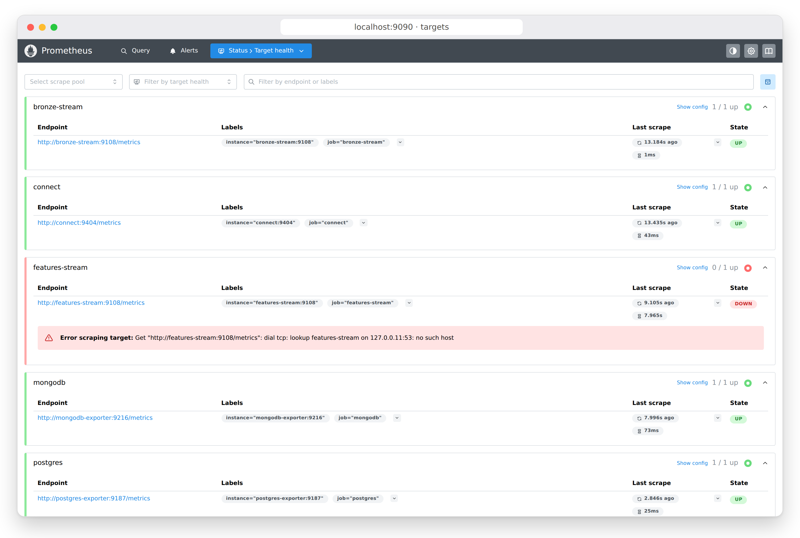
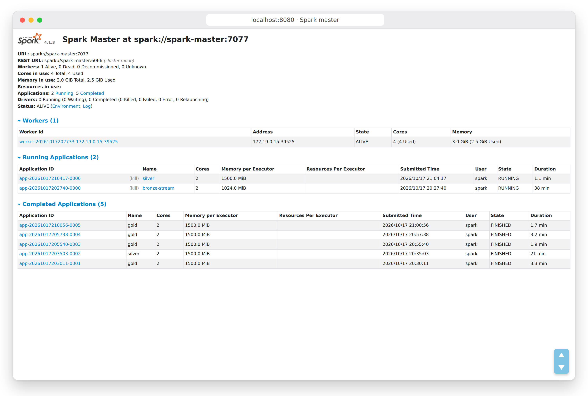
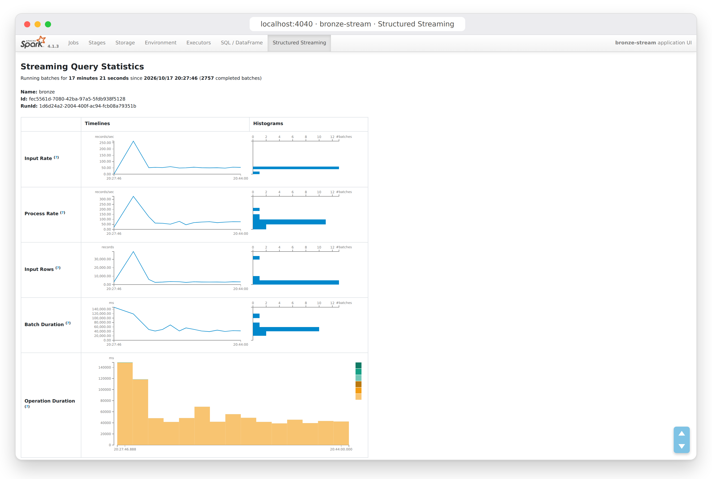

# Gallery: the running stack

Every user interface of the project, captured from the running stack on
2026-10-17 (`scripts/readme_screenshots.py`, 1440 x 900 at 2x, in one
browser frame), at the end of P9. What the lake held is in
[lake-inventory.md](lake-inventory.md); every measurement in
[results.md](results.md); one order followed end to end in [demo.md](demo.md).

## Orchestration: Airflow (`http://localhost:8088`)

The six DAGs. `transform` every 30 minutes, `maintenance` and `graph` daily,
`quality_report` daily, `gdpr_erasure` and `backfill` on demand. The red
marks are real failures, left as they were: `graph` could not reach Neo4j
(the serving profile was stopped: `Name or service not known`), and a
`quality_report` run of the same morning failed.

`transform`'s run history: the slow runs before compaction (40+ minutes),
then about 10 minutes after it (P9 scan cost).

A GDPR erasure: the user deleted from both sources, bronze purged by the
stream, Redis cleaned, the lake erased and verified (1 h 44 min, O5: 24 h).

The run that carried the demo order to gold ([demo.md](demo.md)).

## Dashboards: Grafana (`http://localhost:3000`, P9b)

Pipeline health (Prometheus and Airflow's own database) and the gold marts
(Athena, a marts-only identity, result reuse).

## Monitoring: Prometheus (`http://localhost:9090`)

The alert rules (17, every one with a runbook entry checked in CI), the
scrape targets, and the slot drill as Prometheus recorded it.

## Spark (`http://localhost:8080`, `http://localhost:4040`)

The cluster (the stream holds 2 of the worker's 4 cores, the batch jobs the
other 2) and the bronze query's own statistics.

## Serving: Neo4j and the API (`http://localhost:7474`, `http://localhost:8000`)

